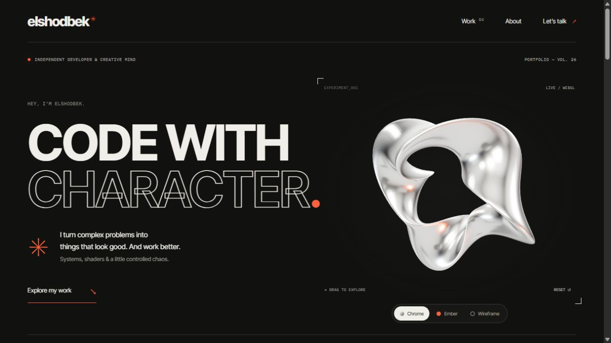

# Elshodbek — Code with character.

A personal portfolio for **Elshodbek Ermuxammadov**: systems, shaders, and software with a point of view.

**[Live website](https://elshod-gosling.github.io/elshod-portfolio/)**



## The experience

- A custom, locally generated Three.js ribbon sculpture, with chrome, ember, and wireframe materials. Drag it, or focus it and use the arrow keys.
- Filterable showcases for Cyberpunk Shader, FinFlow AI, ZEHN-EDU, and elab, with accessible detail dialogs and real project links.
- A responsive editorial layout, mobile navigation, and an Uzbekistan clock.
- Reduced-motion support, a persistent animation toggle, and a static sculpture fallback when WebGL is unavailable.
- Rendering pauses when the sculpture is off screen or the browser tab is hidden.
- Self-hosted fonts and artwork. No analytics, remote fonts, backend, or account required.

## Run locally

Use Node.js 24 and npm:

```sh
npm ci
npm run dev
```

To build and preview the production output:

```sh
npm run build
npm run preview
```

The production files are generated in `dist/`. Relative asset paths support GitHub Pages project hosting or any static web host.

## Edit

- `index.html`: page content, project covers, links, biography, and honors.
- `src/main.js`: project descriptions, filters, dialogs, navigation, time, and motion preferences.
- `src/sculpture.js`: parametric geometry, rendering, materials, and input handling.
- `src/style.css`: typography, layout, colors, responsive styles, and motion.
- `public/assets/`: optimized project artwork.

Pushes to `main` run `.github/workflows/pages.yml` to build and deploy to GitHub Pages. Repository **Settings → Pages → Source** should be set to **GitHub Actions**.

## Content and artwork

Biography, social links, and competition results are carried forward from [Elshodbek’s previous portfolio](https://el-port.iceiy.com/?i=1). Project descriptions are grounded in the public repositories. No new clients, awards, download counts, or performance claims are invented.

- Cyberpunk artwork: `2026-09-03_10.34.33.png` from [Cyberpunk-shader-.build](https://github.com/elshod-gosling/Cyberpunk-shader-.build), resized and encoded as WebP.
- Learning-world artwork: `dist/assets/quest-worlds.webp` from [ZEHN-EDU](https://github.com/elshod-gosling/ZEHN-EDU).
- FinFlow’s cover is an illustrative editorial graphic, not a screenshot of financial results.
- elab’s terminal is explicitly illustrative, not a claim about an actual library API.
- The hero sculpture is generated in code. Typography uses Inter Tight and IBM Plex Mono, distributed through Fontsource under their bundled open font licenses.

## Verification

Production build and dependency audit completed locally. Desktop, tablet, and phone layouts, gallery filters, project dialogs, keyboard navigation, mobile menu, material selection, and the persistent motion control are checked in the browser before publication.
